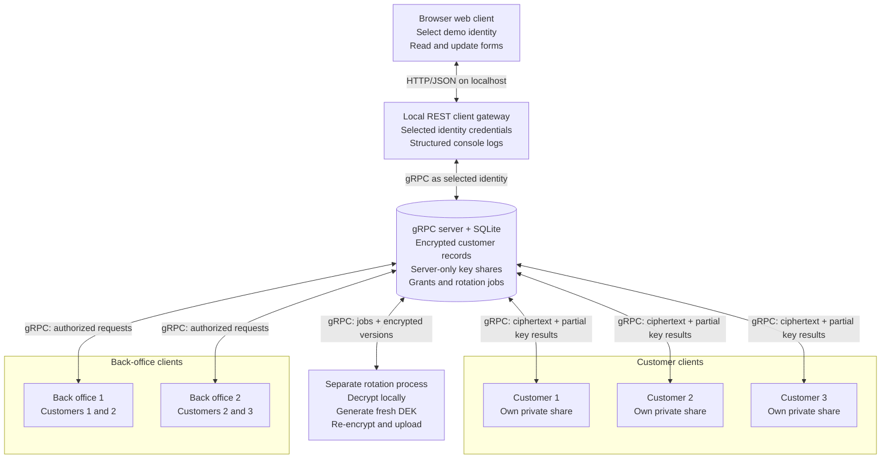

# System architecture

The diagram shows the logical process boundaries and data flow in this educational demo. All six client identities are separate from the server identity; the CLI is launched separately for each identity. The localhost REST gateway can load one of the five customer or back-office identity files selected in its browser UI. The rotation process is privileged and can access plaintext during re-encryption.

**Trust boundary:** The server's application API does not require plaintext or DEKs. The REST gateway is a client process and handles plaintext plus the selected identity's token and private share. Because its dropdown deliberately permits identity impersonation, it must remain local and is not a production authentication design. The bootstrap process is trusted and initially generates both sets of key shares; this demo does not establish security against a compromised provisioning environment or a malicious server. The rotation process also handles plaintext and DEKs.
