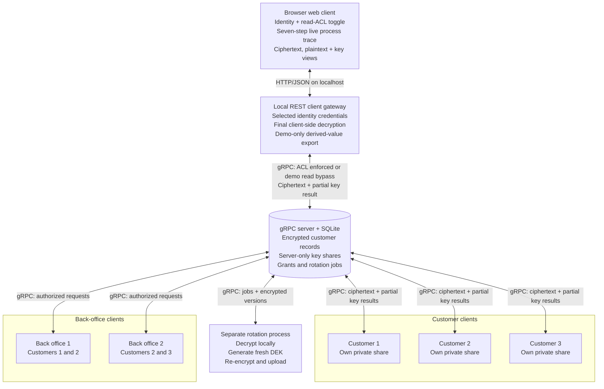

# System architecture

The diagram shows the logical process boundaries and data flow in this educational demo. All six client identities are separate from the server identity; the CLI is launched separately for each identity. The localhost REST gateway can load any of the six identity files selected in its browser UI, including the privileged rotation identity. In the web path rotation can read every record for inspection, while customer-data updates remain owner-only. The separate rotation process uses that identity for controlled maintenance writes and can access plaintext during re-encryption. A demo toggle can bypass read ACL checks so the UI can show that releasing the wrong ciphertext still does not give an identity its missing encrypted DEK envelope.

**Trust boundary:** The server's application API does not require plaintext or DEKs. Even in bypass mode it authenticates the caller and cryptographically binds its partial key result to that caller's recipient envelope; write and administrative authorization remain enabled. The REST gateway is a client process and handles plaintext plus the selected identity's token and private share. Its educational process trace returns the ephemeral, server-partial, client-partial, and combined P-256 points plus the derived KEK and recovered DEK to the browser. Neither private scalar share is returned. The browser can impersonate the privileged rotation identity for read-only inspection, but the REST update endpoint explicitly accepts only the customer owner. Exporting the KEK or DEK is forbidden in a production design. Because the UI dropdown, trace, and read-authorization bypass permit unsafe demo actions, the stack must remain local and is not a production authentication design. The bootstrap process is trusted and initially generates both sets of key shares; this demo does not establish security against a compromised provisioning environment or a malicious server. The separate rotation process also handles plaintext and DEKs during controlled maintenance.
