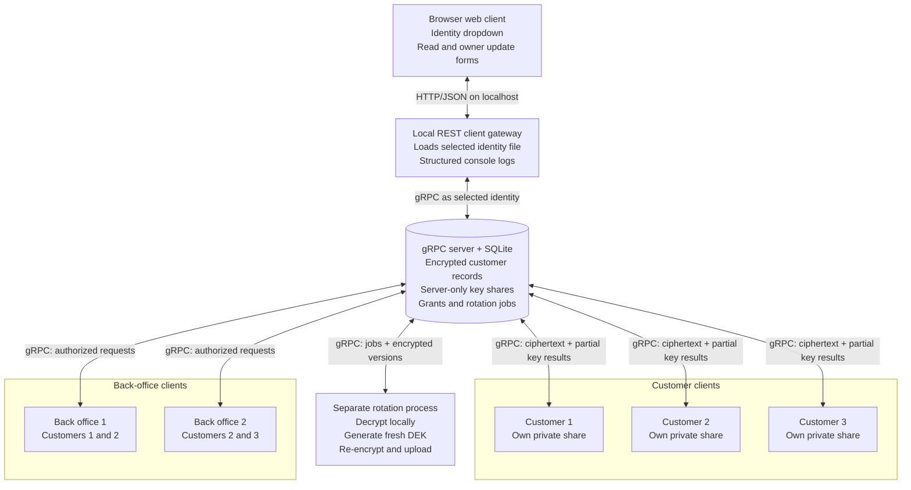

# Customer Crypto gRPC v2 (educational proof of concept)

A local, **non-production** Go demo with a SQLite-backed gRPC server, three separate customer identities, two backoffice identities, one independent rotation process, and a REST-backed browser client. The server handles ciphertext and **server-side private shares only**; decryption and re-encryption happen in a client, web-gateway, or rotation process.

## Architecture diagram

See [ARCHITECTURE.md](ARCHITECTURE.md) for the Mermaid diagram of the server, three customer clients, two back-office clients, and separate rotation process.



## Requirements

- Go 1.23+
- GNU Make
- `curl` for the REST integration checks
- Node.js only for the optional `make check-js` syntax check
- A modern browser for the web client
- Internet access **once** for `go mod tidy` (dependencies: `google.golang.org/grpc`, `modernc.org/sqlite`)
- Localhost only; this demo deliberately uses plaintext HTTP/gRPC, bearer tokens, and a web gateway that can select any demo identity. Do **not** expose it to a network.

## Run

Start a fresh disposable demo stack with one command:

```bash
make demo
```

Open [http://127.0.0.1:8080](http://127.0.0.1:8080). `make demo` provisions and seeds a temporary database, starts both the gRPC and REST/web servers, and writes request logs to the terminal. Press Ctrl+C to stop both servers and remove the temporary credentials and database. It does not overwrite `demo.db` or `identities/` in the repository.

For a persistent manual demo, provision the repository paths once:

```bash
make reset bootstrap
```

Then run `make server` in one terminal. In a second terminal, run `make seed` once followed by `make web`. The browser client lets you select any customer or back-office identity, try each customer record, and edit a record when the selected customer owns it.

Run all checks and the end-to-end integration scenario with:

```bash
make deps
make check
make check-js
make integration
```

`make integration` runs `scripts/integration.sh`, which recreates repository-local `demo.db` and `identities/`. It exercises the complete access matrix twice. In each round, all three customers and both back-office identities attempt to read each of `C001`, `C002`, and `C003`; expected reads must succeed and expected denials must return HTTP 403. Between the rounds, `backoffice1` is checked to ensure it cannot update `C001`, then `customer1` changes the `city` field of its own record to `Gothenburg`. That owner update creates version 2 by generating a fresh DEK, re-encrypting locally, and producing fresh envelopes for every active recipient.

### Make commands

Run `make help` for the complete command summary. All application flags have Make variables, so the same targets work with alternate paths and ports.

| Target | Purpose |
| --- | --- |
| `make demo` | Start a complete temporary interactive stack |
| `make deps` | Download and tidy Go modules |
| `make test` | Run all Go tests |
| `make vet` | Run `go vet ./...` |
| `make check` | Run tests, vet, and shell syntax checks |
| `make check-js` | Check browser JavaScript syntax with Node.js |
| `make integration` | Run the full REST + gRPC integration scenario |
| `make reset` | Remove the configured repository-local database and identities |
| `make bootstrap` | Provision principals, key shares, grants, and ownership |
| `make server` | Start the gRPC server in the foreground |
| `make seed` | Encrypt and seed the three initial records |
| `make web` | Start the REST API and browser client in the foreground |
| `make client` | Read a record with the selected identity |
| `make update` | Update one field as the owning customer |
| `make revoke` | Revoke the selected principal |
| `make jobs` | List pending revocation-rotation jobs |
| `make rotate` | Process all pending rotation jobs |
| `make rest-health` | Call the REST readiness endpoint |
| `make rest-config` | Read the public demo identity and ACL configuration |
| `make rest-read` | Read a record through REST |
| `make rest-update` | Update a record through REST |

Common overrides are `DB`, `IDENTITIES`, `GRPC_ADDR`, `WEB_ADDR`, `IDENTITY`, `OBJECT`, `VERSION`, `FIELD`, `VALUE`, and `TARGET`. For example:

```bash
make client IDENTITY=backoffice1 OBJECT=C002
make client IDENTITY=customer1 OBJECT=C002 # access denied
make update IDENTITY=customer1 OBJECT=C001 FIELD=city VALUE=Gothenburg
make revoke TARGET=backoffice1
make jobs
make rotate
```

### REST and web client

`cmd/web` is a separate localhost client gateway. It serves the embedded HTML, CSS, and JavaScript and translates REST requests into authenticated gRPC client calls. It loads the credential file belonging to the identity selected in the browser; the gRPC server itself continues to load only SQLite and no client identity files.

| Method | Path | Purpose |
| --- | --- | --- |
| `GET` | `/api/v1/health` | REST process readiness |
| `GET` | `/api/v1/config` | Demo identities, roles, objects, and expected ACL |
| `GET` | `/api/v1/records/{id}` | Fetch and decrypt the latest authorized version |
| `PATCH` | `/api/v1/records/{id}` | Update allowed string fields and create a fresh-key version |

Record requests require the selected identity in the `X-Demo-Identity` header. The REST process never returns tokens or private shares.

```bash
make rest-health
make rest-config
make rest-read IDENTITY=customer1 OBJECT=C001
make rest-update IDENTITY=customer1 OBJECT=C001 FIELD=city VALUE=Gothenburg
```

The browser writes identity changes, requests, response statuses, request IDs, and failures to both its visible activity panel and the browser developer console. The REST terminal logs one structured line per request plus record-read and record-update events, including the request ID, actor, object, status, duration, and changed field names. Credentials and decrypted record values are deliberately omitted from logs.

### Roles and ACL

| Principal | C001 | C002 | C003 |
| --- | --- | --- | --- |
| customer1 | yes | no | no |
| customer2 | no | yes | no |
| customer3 | no | no | yes |
| backoffice1 | yes | yes | no |
| backoffice2 | no | yes | yes |
| rotation | yes | yes | yes |

The three customer records are fictional JSON containing ID, name, email, phone, city, and notes. A customer may update only the record it owns. Back-office identities have read access according to the table but cannot update customer records. **Only ciphertext is stored in `objects.ciphertext`**. Client-specific encrypted DEK envelopes are stored in the same JSON ciphertext record. Metadata (IDs, ownership, grants, versions, roles) is **not encrypted**.

## Separation and cryptographic flow

1. A dedicated **bootstrap provisioning program** creates server shares in SQLite and client shares in `identities/*.json` (0600). It briefly handles both sets of shares: it is a **trusted provisioning step** and must not be deployed as the server or run on an untrusted server. In production use independently generated shares, attested enrollment, and authenticated key registration.
2. `cmd/server` opens only SQLite; no client secret file is loaded. It serves JSON-coded unary gRPC (`/demo.Crypto/Call`). This is gRPC, but uses a JSON codec rather than generated protobuf stubs.
3. `cmd/web` is a separate client-side gateway. For each REST request, it loads the locally selected identity, calls gRPC with that identity's bearer token, and performs authorized decryption or re-encryption in the gateway process.
4. `cmd/rotation -action seed` creates one random AES-256-GCM DEK per customer record; it encrypts the JSON locally and wraps the DEK under each authorized recipient's combined public key. The server receives ciphertext and encrypted DEK envelopes only.
5. Client fetches ciphertext and requests a server partial point for its exact envelope's ephemeral public point. Client adds its private scalar multiplication, unwraps DEK, and decrypts AES-GCM locally.
6. An owning customer can use the web form, REST `PATCH`, or CLI `-set name=value` to update allowed string fields. The client decrypts the latest version locally, changes the fields, generates a fresh DEK, and uploads the next encrypted version. The server checks ownership, the exact active recipient set, and the expected next version. Back-office identities cannot use this update path.
7. `revoke` immediately disables the principal and queues rotations for its accessible objects. The rotation process fetches the old version, decrypts locally, generates a fresh DEK, re-encrypts locally, and uploads the next version with envelopes for the **remaining** recipients. Server verifies recipient set and expected version before atomic SQLite commit.

## Limits (important)

- **Not audited**: this hand-built P-256 additive-share KEM is illustrative, not a standard threshold encryption protocol with a formal security proof. Replace with a reviewed construction for production.
- **No forward revocation of cached material**: a revoked client holding a previously delivered partial point, its secret, and old ciphertext can still decrypt that old version offline. Old ciphertext versions are intentionally retained to demonstrate this limitation.
- **Trusted rotation process**: it sees all plaintext and DEKs during rotation. Server never receives these through its API, but the rotation principal is highly privileged.
- **Trusted provisioning**: the bootstrap command handles both server and client secrets. It is not safe to run on the server if the server operator must be unable to learn client secrets during provisioning.
- **No network security**: gRPC uses insecure transport and bearer tokens; localhost only. Replace with mTLS and identity binding before network use.
- **The identity dropdown is not authentication**: the REST gateway holds all five demo credential files and deliberately lets any browser user act as any listed identity. It is a local ACL demonstration only. A production design requires real user authentication, server-side session binding, CSRF protection, and credentials isolated per user.
- **No confidential client authentication against a compromised server**: the server controls authorization and can be malicious; metadata and recipient public keys must be authenticated externally. A malicious server can attempt public-key substitution, malformed ciphertext, or selectively withhold rotations. Implement signed key directories, authenticated commitments, and a reviewed protocol.
- **No secure key storage**: client shares are plaintext JSON files with filesystem permissions. Production requires OS key store/HSM, zeroization considerations, key backup, and enrollment controls.
- **No tamper-proof audit log**, no job retries/leases, no streaming events, no persistent agent processes (the rotation program is invoked separately), no revocation race guarantees beyond the SQLite transaction boundaries.

## Verification status

`make check`, `make check-js`, and `make integration` pass in the current development environment. The disposable `make demo` stack also serves its health and configuration endpoints and removes its temporary data when stopped. The integration test checks the embedded web page, covers the complete REST read ACL before and after an owner update, rejects a back-office update, verifies the updated value after fresh-key re-encryption, and confirms structured REST logging. Do not interpret the architectural separation as a formal proof that server memory can never contain plaintext under all possible malicious inputs or compromised code.

## Language review

All documentation, source comments, CLI messages, and sample customer record values are in English. Personal names and place names remain unchanged as proper nouns.
