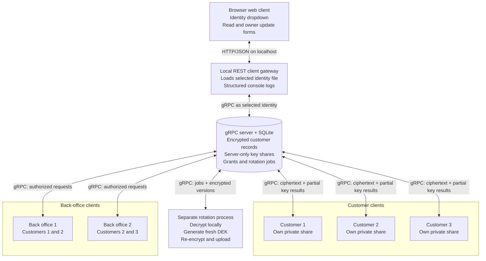

# Customer Crypto gRPC v2 (educational proof of concept)

A local, **non-production** Go demo with a SQLite-backed gRPC server, three separate customer identities, two backoffice identities, one independent rotation process, and a REST-backed browser client. The server handles ciphertext and **server-side private shares only**; decryption and re-encryption happen in a client, web-gateway, or rotation process.

## Architecture diagram

See [ARCHITECTURE.md](ARCHITECTURE.md) for the Mermaid diagram of the server, three customer clients, two back-office clients, and separate rotation process.



## Requirements

- Go 1.23+
- GNU Make
- `curl` for the REST integration checks
- Node.js only for the optional `make check-js` syntax check
- A modern browser for the web client
- Internet access **once** for `go mod tidy` (dependencies: `google.golang.org/grpc`, `modernc.org/sqlite`)
- Localhost only; this demo deliberately uses plaintext HTTP/gRPC, bearer tokens, and a web gateway that can select any demo identity. Do **not** expose it to a network.

## Run

Start a fresh disposable demo stack with one command:

```bash
make demo
```

Open [http://127.0.0.1:8080](http://127.0.0.1:8080). `make demo` provisions and seeds a temporary database, starts both the gRPC and REST/web servers, and writes request logs to the terminal. The UI can switch identities, disable server read authorization for an encryption-only access demonstration, and compare the stored ciphertext with the selected client’s decryption result. Press Ctrl+C to stop both servers and remove the temporary credentials and database. It does not overwrite `demo.db` or `identities/` in the repository.

For a persistent manual demo, provision the repository paths once:

```bash
make reset bootstrap
```

Then run `make server` in one terminal. In a second terminal, run `make seed` once followed by `make web`. The browser client lets you select any customer, back-office, or privileged rotation identity, try each customer record, and edit a record only when the selected customer owns it.

Run all checks and the end-to-end integration scenario with:

```bash
make deps
make check
make check-js
make integration
```

`make integration` runs `scripts/integration.sh`, which recreates repository-local `demo.db` and `identities/`. It exercises the complete access matrix twice. In each round, all three customers, both back-office identities, and the rotation identity attempt to read each of `C001`, `C002`, and `C003`; expected reads must succeed and expected denials must return HTTP 403. It also disables server read authorization, confirms that `customer1` receives the stored ciphertext for `C002` but cannot decrypt it without a recipient envelope, and confirms that write authorization remains active. The rotation identity must decrypt all three records through its own envelopes but must receive HTTP 403 from the browser update endpoint. Between the rounds, `customer1` changes the `city` field of its own record to `Gothenburg`. That owner update creates version 2 by generating a fresh DEK, re-encrypting locally, and producing fresh envelopes for every active recipient.

### Make commands

Run `make help` for the complete command summary. All application flags have Make variables, so the same targets work with alternate paths and ports.

| Target | Purpose |
| --- | --- |
| `make demo` | Start a complete temporary interactive stack |
| `make deps` | Download and tidy Go modules |
| `make test` | Run all Go tests |
| `make vet` | Run `go vet ./...` |
| `make check` | Run tests, vet, and shell syntax checks |
| `make check-js` | Check browser JavaScript syntax with Node.js |
| `make integration` | Run the full REST + gRPC integration scenario |
| `make reset` | Remove the configured repository-local database and identities |
| `make bootstrap` | Provision principals, key shares, grants, and ownership |
| `make server` | Start the gRPC server in the foreground |
| `make seed` | Encrypt and seed the three initial records |
| `make web` | Start the REST API and browser client in the foreground |
| `make client` | Read a record with the selected identity |
| `make update` | Update one field as the owning customer |
| `make revoke` | Revoke the selected principal |
| `make jobs` | List pending revocation-rotation jobs |
| `make rotate` | Process all pending rotation jobs |
| `make rest-health` | Call the REST readiness endpoint |
| `make rest-config` | Read the public demo identity and ACL configuration |
| `make rest-read` | Read a record through REST |
| `make rest-update` | Update a record through REST |

Common overrides are `DB`, `IDENTITIES`, `GRPC_ADDR`, `WEB_ADDR`, `IDENTITY`, `OBJECT`, `VERSION`, `FIELD`, `VALUE`, `TARGET`, and `BYPASS_READ_AUTHORIZATION`. For example:

```bash
make client IDENTITY=backoffice1 OBJECT=C002
make client IDENTITY=customer1 OBJECT=C002 # access denied
make update IDENTITY=customer1 OBJECT=C001 FIELD=city VALUE=Gothenburg
make rest-read IDENTITY=customer1 OBJECT=C002 BYPASS_READ_AUTHORIZATION=true
make revoke TARGET=backoffice1
make jobs
make rotate
```

### REST and web client

`cmd/web` is a separate localhost client gateway. It serves the embedded HTML, CSS, and JavaScript and translates REST requests into authenticated gRPC client calls. It loads the credential file belonging to the identity selected in the browser; the gRPC server itself continues to load only SQLite and no client identity files.

The identity dropdown contains all six encrypted-data recipients: three customers, two back-office identities, and the privileged `rotation` identity. Rotation is a recipient for every customer record because it must decrypt and re-encrypt data after revocation. Selecting it demonstrates that access through its own envelope, but the web form and REST `PATCH` route do not grant it interactive customer-data updates. Rotation writes remain confined to the separate `cmd/rotation` maintenance workflow.

### What the rotation service is used for

Rotation is a **separate trusted client process**, not code that decrypts records inside the gRPC server. It has its own client credential and one recipient envelope on every customer record. That permanent access lets it perform two maintenance tasks:

- **Initial seeding:** `make seed` runs the rotation client to create the first encrypted version of C001, C002, and C003.
- **Re-encryption after revocation:** `make revoke TARGET=<identity>` disables an identity and queues each affected record. `make rotate` processes those jobs.

For each queued record, rotation performs this sequence:

1. Fetch the latest ciphertext and use the rotation envelope plus both threshold shares to decrypt it locally.
2. Generate a fresh random 256-bit object DEK and nonce.
3. Encrypt the unchanged plaintext into a new ciphertext version.
4. Fetch the active recipient public keys and wrap the fresh DEK separately for each remaining recipient. The revoked identity receives no envelope in the new version.
5. Upload the encrypted version. The server checks the expected next version and exact active recipient set before committing it.

This workflow rotates the **object DEK, ciphertext, nonce, and recipient envelopes**. It does not rotate the principals’ long-lived server/client scalar shares. The rotation process is highly trusted because plaintext and DEKs exist briefly in its memory. The gRPC server still receives only encrypted objects.

Selecting `rotation` in the browser is an inspection aid: it shows that rotation can independently unwrap each record’s DEK and explains why its envelope is always present. It does not seed data, poll jobs, revoke identities, or run re-encryption. Those actions remain in the command workflow:

```bash
make revoke TARGET=backoffice1
make jobs
make rotate
```

Revocation cannot erase material already obtained by a client. A revoked identity that cached an old ciphertext, its envelope, and a previously returned partial point may still decrypt that old version offline. Rotation protects subsequent versions by using a fresh DEK and omitting the revoked identity’s envelope.

| Method | Path | Purpose |
| --- | --- | --- |
| `GET` | `/api/v1/health` | REST process readiness |
| `GET` | `/api/v1/config` | Demo identities, roles, objects, and expected ACL |
| `GET` | `/api/v1/records/{id}` | Fetch the stored encrypted representation, attempt client-side decryption, and return the educational process trace |
| `PATCH` | `/api/v1/records/{id}` | Update allowed string fields, create a fresh-key version, and trace verification of the new version |

Record requests require the selected identity in the `X-Demo-Identity` header. The REST process never returns tokens or private shares. For this educational UI only, a successfully decrypted response does return the recovered object DEK in hexadecimal so its relationship to every recipient envelope can be inspected.

```bash
make rest-health
make rest-config
make rest-read IDENTITY=customer1 OBJECT=C001
make rest-read IDENTITY=customer1 OBJECT=C002 BYPASS_READ_AUTHORIZATION=true
make rest-update IDENTITY=customer1 OBJECT=C001 FIELD=city VALUE=Gothenburg
```

The **Disable server read authorization** toggle sends `X-Demo-Read-Authorization: disabled` on record reads. In this mode the gRPC server skips its grant lookup for ciphertext fetches and partial-key requests. It still authenticates the identity token, rejects revoked principals, binds partial-key results to that identity’s envelope, and enforces all upload, ownership, rotation, and administrative checks.

With the toggle enabled, any authenticated demo identity can receive any record’s stored ciphertext. An identity listed in that encrypted record’s recipient envelopes can complete decryption. A different identity receives the same ciphertext but gets `decrypted: false` because it has no wrapped DEK intended for it. This demonstrates encryption as a second access boundary after server authorization.

### Envelope visualizer

The **One locked record, several named envelopes** section gives the envelope scheme a concrete picture:

- The encrypted customer record is one locked box. It is encrypted once with one random data-encryption key (DEK).
- Beside that box, SQLite stores one named envelope for every allowed recipient. An envelope contains an encrypted copy of the DEK, never the customer fields themselves.
- Every envelope wraps the same DEK, but each has different bytes because it is protected for a particular recipient with its own KEK and nonce.
- On a read, the selected identity can follow only the envelope carrying its name. Opening that envelope recovers the DEK; the DEK then opens the shared ciphertext.

This is a live diagram, not a fixed example. Reading a record fills it with the actual object version, ciphertext size, recipient names, abbreviated wrapped-DEK values, selected envelope, derived KEK and recovered DEK from that request. A successful path turns green. With the server read ACL bypassed, a wrong identity sees the locked box and all stored envelope names, but a red missing-envelope card stops the path before DEK recovery. With normal authorization enabled, a denied read stops earlier and the diagram explains that neither the ciphertext nor envelope map reached the client.

The expandable **Show the cryptographic names behind the picture** panel maps the analogy to `DEK`, `KEK`, recipient envelope, and wrapped DEK. It also shows the complete dependency in one line: recipient envelope → KEK unwrap → DEK → shared ciphertext → plaintext.

The **Live cryptographic process** section turns every read into a seven-step walkthrough using values from that exact request:

1. **Browser and client gateway request** — the browser selects an identity and object. The local gateway loads that identity’s token and private scalar share; neither secret value is displayed.
2. **Server authentication and authorization** — the gRPC server validates the token and revocation state, then either applies the read ACL or records that the demo bypass skipped the ACL. An ordinary denied read stops here, before ciphertext is released.
3. **Database ciphertext** — SQLite returns the record nonce, AES-GCM ciphertext, and the recipient envelope map. The trace shows sizes, recipients, and the nonce; the exact stored JSON appears below it.
4. **Server partial point** — for the selected identity’s envelope point `R`, the server computes `S = x_server × R`. It returns `S`; the private scalar `x_server` remains inside the server.
5. **Client combined point** — the gateway computes `C = x_client × R`, then `Z = S + C`. The private scalar `x_client` remains inside the gateway.
6. **Client DEK unwrap** — an HMAC-SHA-256 KDF derives a KEK from `Z` and the envelope AAD. AES-GCM uses that KEK to unwrap the object DEK. The trace exposes the KEK and DEK only for this educational demo.
7. **Client plaintext** — AES-256-GCM uses the DEK, record nonce, ciphertext, and record AAD. After authentication succeeds, the gateway decodes the customer JSON and returns it to the browser. The gRPC server never receives this plaintext.

Each step is labeled with the process that owns it and changes from waiting to allowed, bypassed, blocked, or not reached. In enforced mode a wrong-user read stops at step 2. In bypass mode the same read reaches step 3, then stops at step 4 because that identity has no recipient envelope. A successful read reaches step 7 and shows the real ephemeral, partial, and combined P-256 points. After an update, the trace follows the newly encrypted version through the same verification path.

The comparison section below the customer cards shows:

1. **Database stores** — the JSON held in SQLite’s `objects.ciphertext` column, including the record nonce, AES-GCM ciphertext, and recipient-specific encrypted DEK envelopes.
2. **After client-side decryption** — plaintext only when the selected identity can combine its private share with the server’s partial key result.
3. **Each party’s DEK view** — one row per recipient showing its distinct wrapped-DEK value and wrap nonce. There is only one plaintext DEK per object version, so every valid envelope unwraps to the same 256-bit value. The row for the selected identity states which envelope was actually opened; the other rows show the same object DEK while clearly stating that their envelopes were not opened during that request.

The second panel is deliberately labeled client-side decryption. The gRPC server does not decrypt customer records and never receives the displayed plaintext or unwrapped DEK; the local REST client gateway performs the final decryption on behalf of the selected demo identity. When a wrong identity fetches exposed ciphertext, the UI lists the stored recipient envelopes but cannot show an unwrapped DEK.

The browser writes identity changes, requests, response statuses, request IDs, and failures to both its visible activity panel and the browser developer console. The REST terminal logs one structured line per request plus record-read and record-update events, including the request ID, actor, object, status, duration, and changed field names. Credentials and decrypted record values are deliberately omitted from logs.

### Roles and ACL

| Principal | C001 | C002 | C003 |
| --- | --- | --- | --- |
| customer1 | yes | no | no |
| customer2 | no | yes | no |
| customer3 | no | no | yes |
| backoffice1 | yes | yes | no |
| backoffice2 | no | yes | yes |
| rotation | yes | yes | yes |

The three customer records are fictional JSON containing ID, name, email, phone, city, and notes. A customer may update only the record it owns. Back-office identities have their listed read access but cannot update customer records. Rotation can read every record through its recipient envelope, while interactive browser/REST updates remain customer-owner-only. The UI’s read-authorization toggle can deliberately bypass the table for ciphertext retrieval, but it does not create a recipient envelope or grant decryption capability. **Only ciphertext is stored in `objects.ciphertext`**. Client-specific encrypted DEK envelopes are stored in the same JSON ciphertext record. Metadata (IDs, ownership, grants, versions, roles) is **not encrypted**.

## Separation and cryptographic flow

1. A dedicated **bootstrap provisioning program** creates server shares in SQLite and client shares in `identities/*.json` (0600). It briefly handles both sets of shares: it is a **trusted provisioning step** and must not be deployed as the server or run on an untrusted server. In production use independently generated shares, attested enrollment, and authenticated key registration.
2. `cmd/server` opens only SQLite; no client secret file is loaded. It serves JSON-coded unary gRPC (`/demo.Crypto/Call`). This is gRPC, but uses a JSON codec rather than generated protobuf stubs.
3. `cmd/web` is a separate client-side gateway. For each REST request, it loads the locally selected identity, calls gRPC with that identity's bearer token, and performs authorized decryption in the gateway process. Its update endpoint performs re-encryption only for the customer owner; selecting the rotation identity permits reads for inspection but not maintenance writes.
4. `cmd/rotation -action seed` creates one random AES-256-GCM DEK per customer record; it encrypts the JSON locally and wraps the DEK under each authorized recipient's combined public key. The server receives ciphertext and encrypted DEK envelopes only.
5. Client fetches ciphertext and requests a server partial point for its exact envelope's ephemeral public point. Client adds its private scalar multiplication, derives the KEK, unwraps the DEK, and decrypts AES-GCM locally. The demo web response additionally exposes the derived points, KEK, and unwrapped DEK as hex for the live walkthrough; it never exposes either private scalar share. Normal applications must keep all derived key material inside the cryptographic boundary.
6. An owning customer can use the web form, REST `PATCH`, or CLI `-set name=value` to update allowed string fields. The client decrypts the latest version locally, changes the fields, generates a fresh DEK, and uploads the next encrypted version. The server checks ownership, the exact active recipient set, and the expected next version. Back-office identities cannot use this update path.
7. `revoke` immediately disables the principal and queues rotations for its accessible objects. The rotation process fetches the old version, decrypts locally, generates a fresh DEK, re-encrypts locally, and uploads the next version with envelopes for the **remaining** recipients. Server verifies recipient set and expected version before atomic SQLite commit.

## Limits (important)

- **Not audited**: this hand-built P-256 additive-share KEM is illustrative, not a standard threshold encryption protocol with a formal security proof. Replace with a reviewed construction for production.
- **No forward revocation of cached material**: a revoked client holding a previously delivered partial point, its secret, and old ciphertext can still decrypt that old version offline. Old ciphertext versions are intentionally retained to demonstrate this limitation.
- **Trusted rotation process**: it sees all plaintext and DEKs during rotation. Server never receives these through its API, but the rotation principal is highly privileged.
- **Trusted provisioning**: the bootstrap command handles both server and client secrets. It is not safe to run on the server if the server operator must be unable to learn client secrets during provisioning.
- **No network security**: gRPC uses insecure transport and bearer tokens; localhost only. Replace with mTLS and identity binding before network use.
- **The identity dropdown is not authentication**: the REST gateway holds all six demo credential files and deliberately lets any browser user act as any listed identity, including the privileged rotation service. It is a local ACL demonstration only. A production design requires real user authentication, server-side session binding, CSRF protection, and credentials isolated per user.
- **The read-authorization bypass is intentionally caller-controlled**: it exists only to demonstrate what encryption protects after ciphertext disclosure. Do not include such a bypass header or runtime switch in a production service.
- **The UI deliberately reveals derived points, KEKs, and recovered DEKs**: this makes every decryption step and envelope relationship visible but is unsafe outside this local demonstration. Production APIs and user interfaces must never return, render, log, or otherwise export KEKs or plaintext DEKs. The demo still keeps both private scalar shares hidden.
- **No confidential client authentication against a compromised server**: the server controls authorization and can be malicious; metadata and recipient public keys must be authenticated externally. A malicious server can attempt public-key substitution, malformed ciphertext, or selectively withhold rotations. Implement signed key directories, authenticated commitments, and a reviewed protocol.
- **No secure key storage**: client shares are plaintext JSON files with filesystem permissions. Production requires OS key store/HSM, zeroization considerations, key backup, and enrollment controls.
- **No tamper-proof audit log**, no job retries/leases, no streaming events, no persistent agent processes (the rotation program is invoked separately), no revocation race guarantees beyond the SQLite transaction boundaries.

## Verification status

`make check`, `make check-js`, and `make integration` pass in the current development environment. The disposable `make demo` stack also serves its health and configuration endpoints and removes its temporary data when stopped. The integration test checks the embedded envelope visualizer assets, covers the complete REST read ACL before and after an owner update, verifies the completed trace contains valid-sized server/client/combined P-256 points and a 256-bit KEK, proves that bypass mode releases wrong-user ciphertext without any partial point, KEK, DEK, or plaintext, confirms that `customer1`, `backoffice1`, and `rotation` independently unwrap the same C001 DEK, rejects back-office and rotation updates through the browser REST path, and confirms that fresh-key re-encryption changes the displayed DEK. Do not interpret the architectural separation as a formal proof that server memory can never contain plaintext under all possible malicious inputs or compromised code.

## Language review

All documentation, source comments, CLI messages, and sample customer record values are in English. Personal names and place names remain unchanged as proper nouns.
